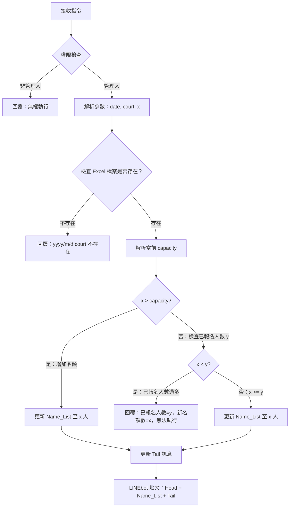
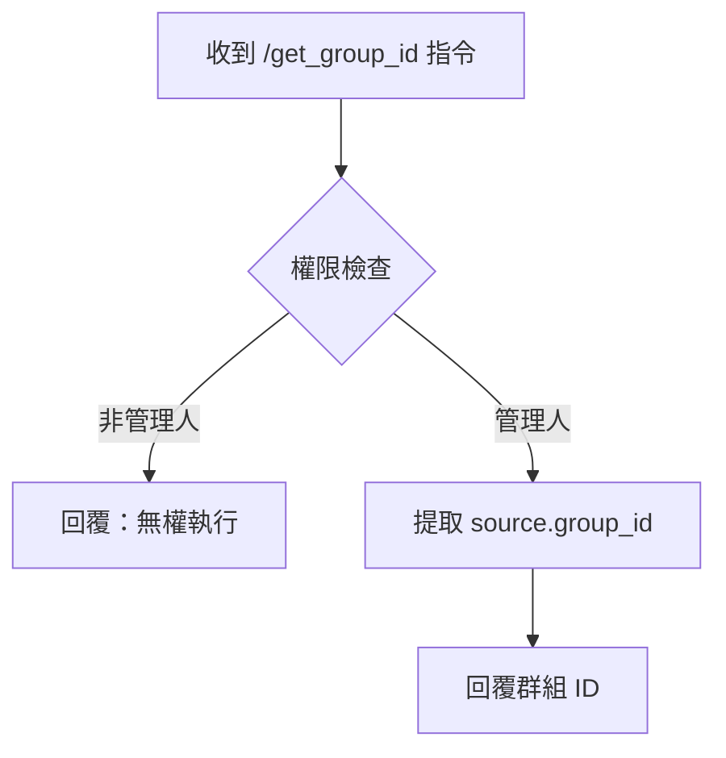

# 報名系統指令集規格書

> 版本：v02  
> 建立日期：2026-10-30  
> 更新日期：2026-10-30（新增 /get_group_id 指令）
> 適用專案：LINE 群組羽球報名系統

---

## 目錄

1. [概述](#1-概述)
2. [管理人名單儲存](#2-管理人名單儲存)
3. [權限檢查服務](#3-權限檢查服務)
4. [指令規範](#4-指令規範)
   - 4.1 `/capacity` 指令
   - 4.2 `/get_group_id` 指令
5. [群組成員收集](#5-群組成員收集)
6. [檔案結構](#6-檔案結構)
7. [實作狀態追蹤](#7-實作狀態追蹤)

---

## 1. 概述

本規格書定義 LINE 群組羽球報名系統的管理指令集，包含管理人權限控制、名額調整指令，以及群組成員資料收集機制。

### 核心設計原則

| 原則 | 說明 |
|------|------|
| JSON 儲存 | 管理人名單以 JSON 格式儲存於 `app/data/admin_list.json` |
| 權限管控 | 僅名單上的 `user_id` 可執行管理指令 |
| Excel 來源 | 場次資料存儲於 Excel 檔案，動態解析名額與報名狀態 |
| 免 .env 設定 | 新群組加入時，透過 `/get_group_id` 指令自動取得群組 ID，無需手動編輯 .env |

---

## 2. 管理人名單儲存

### 檔案格式

**檔案位置**：`app/data/admin_list.json`

```json
{
  "managers": [
    "U3bd23e21126de27dda72949b79a63e56"
  ],
  "updated_at": "2026-10-29"
}
```

### 欄位說明

| 欄位 | 型別 | 說明 |
|------|------|------|
| `managers` | `string[]` | 管理人 `user_id` 陣列，支援多人 |
| `updated_at` | `string` | 最後更新日期（ISO 8601 格式建議） |

### 操作規範

- **新增管理人**：追加至 `managers` 陣列，更新 `updated_at`
- **移除管理人**：從 `managers` 陣列移除，更新 `updated_at`
- **初始化**：若檔案不存在，系統應拒絕所有指令並回覆「無權執行此指令」

---

## 3. 權限檢查服務

### 服務檔案

**路徑**：`app/services/permission_service.py`

### 類別定義

```python
import json
from pathlib import Path
from typing import List

class PermissionService:
    def __init__(self):
        self.managers_file = Path("app/data/managers.json")
    
    def is_manager(self, user_id: str) -> bool:
        """檢查 user_id 是否為管理人"""
        if not self.managers_file.exists():
            return False
        
        with open(self.managers_file, 'r', encoding='utf-8') as f:
            data = json.load(f)
        
        return user_id in data.get('managers', [])
```

### 整合點

在 `main.py` 的指令解析前執行權限檢查：

```python
# 在 parse 之前
permission_service = _services.get('permission_service')
if not permission_service.is_manager(user_id):
    if message_text.startswith('/'):
        line_bot_api.reply_message(
            event.reply_token,
            TextSendMessage(text="❌ 無權執行此指令，僅管理人可用")
        )
        return
```

---

## 4. 指令規範

### 4.1 `/capacity` 指令

#### 語法

```
/capacity {date} {court} {x}
```

#### 參數說明

| 參數 | 說明 | 範例 |
|------|------|------|
| `date` | 日期，格式：MM/DD 或 YYYY/M/D | `10/31` 或 `2026/10/31` |
| `court` | 場次時段 | `AM`、`PM` |
| `x` | 新名額數（整數） | `24` |

#### 完整範例

```
/capacity 10/31 PM 24
```

意即：將 10/31 下午場的名額修改為 24 人。

#### 執行流程



#### 詳細邏輯

##### 情境一：增加名額（x > capacity）

1. 解析 Excel 取得當前 `capacity`
2. 擴充 `Name_List` 至序號 1~x
3. 更新 `Tail` 訊息：
   ```
   🌟限制（{x}人），候補可報名，但要候補到才可來打喔！
   🌟新人請看記事本
   🌟到場繳費簽名時，請在簿子簽上您的號碼跟名字（務必跟群組報名一致，以利對帳）
   ```
4. 透過 LINEbot 貼文：`Head + Name_List + Tail`

##### 情境二：減少名額（x < capacity）

1. 解析 Excel 取得當前 `capacity`
2. 計算已報名人數 `y`（`Name_List` 中名字 <> 空白的數量）
3. 檢查 `x < y`：
   - **是**：回覆「已報名人數=y，新名額數=x，無法執行！」
   - **否**（x >= y）：
     - 縮減 `Name_List` 至序號 1~x
     - 更新 `Tail` 訊息（同上）
     - LINEbot 貼文：`Head + Name_List + Tail`

---

### 4.2 `/get_group_id` 指令

#### 目的

當系統需要切換到新群組時，提供一個簡單方法獲取群組 ID，無需手動編輯 `.env` 檔案。

#### 語法

```
/get_group_id
```

#### 參數說明

無參數，直接執行即可。

#### 執行流程



#### 回覆範例

```
📋 當前群組 ID：Uxxxxxxxxxxxxxxxxxxxxx
請複製此 ID 並執行：
python3 scripts/collect_members.py --group-id "Uxxx"
```

#### 技術說明

> **為什麼不能自動取得群組 ID？**
> 
> `source.group_id` 是從 LINE webhook 事件中取得的，只有當 bot **實際收到訊息**時才會存在。
> - `main.py` 運行中：✅ 有 `event.source.group_id`，可以直接使用
> - `collect_members.py` 手動執行：❌ 沒有 event 物件，無法自動取得
> 
> 因此需要一個互動式指令讓 bot 在收到訊息時回覆群組 ID。

---

## 5. 群組成員收集

### 目的

建立群組所有人的 `user_name` 與 `user_id` 對應表，用於後續管理人授權或統計。

### 步驟（新流程 - 免手動編輯 .env）

#### 操作流程

```
1️⃣ 在新 LINE 群組發送指令：
   /get_group_id

2️⃣ Bot 回覆：
   📋 當前群組 ID：Uxxxxxxxxxxxxxxxxxxxxx
   請複製此 ID 並執行：
   python3 scripts/collect_members.py --group-id "Uxxx"

3️⃣ 複製 ID，在 terminal 執行：
   cd /home/robert/workspace/LINE群組羽球報名系統
   python3 scripts/collect_members.py --group-id "Uxxxxxxxxxxxxxxxxxxxxx"

4️⃣ 輸出 Excel 檔案：
   Data/group_members_YYYYMMDD_HHMMSS.xlsx
```

#### 關鍵點

| 項目 | 說明 |
|------|------|
| **不用改 .env** | 直接在命令列傳參數 |
| **換群組時** | 在新群組重複步驟 1-4 |
| **權限檢查** | 需要是管理人才能執行 `/get_group_id` |

這個設計完全符合你的需求 —— 不需要編輯任何配置文件，純指令驅動。

### 輸出欄位

| 欄位 | 說明 |
|------|------|
| `序號` | 1, 2, 3... |
| `LINE ID` | 成員的 `user_id` |
| `暱稱` | 成員的 `display_name` |
| `頭像 URL` | 成員的 `picture_url` |

### 後續應用

拿到 member list 後可執行：

- 手動挑選管理人 → 建立 `app/data/admin_list.json`
- 自動篩選特定群組成員 → 過濾顯示名稱或 ID
- 直接在腳本中加入管理人授權選項

---

## 6. 檔案結構

```
LINE群組羽球報名系統/
├── app/
│   ├── data/
│   │   └── admin_list.json          # 管理人名單
│   └── services/
│       └── permission_service.py    # 權限檢查服務
├── scripts/
│   └── collect_members.py           # 群組成員收集（支援 --group-id 參數）
├── Data/
│   └── group_members_*.xlsx         # 成員清單輸出
└── .env                             # 環境變數（LINE_CHANNEL_ACCESS_TOKEN 等）
```

```

---

## 7. 實作狀態追蹤

| 項目 | 狀態 | 備註 |
|------|------|------|
| `user_id` 讀取 | ✅ 已完成 | `main.py:58` |
| 管理人名單儲存 | ❌ 未完成 | 需建立 `app/data/admin_list.json` |
| 權限驗證邏輯 | ❌ 未完成 | 需實作 `PermissionService` |
| `/capacity` 指令 | ⏳ 待實作 | 參數解析與 Excel 操作 |
| `/get_group_id` 指令 | ⏳ 待實作 | 回覆 source.group_id |
| 群組成員收集 | ⏳ 待實作 | `collect_members.py` 支援 `--group-id` |

---

## 附錄

### A. Excel 檔案格式參考

每次場次的報名資料存儲於獨立 Excel 檔案，結構如下：

| 區段 | 說明 |
|------|------|
| `Head` | 貼文標題區 |
| `Name_List` | 報名人名單（序號 1~capacity） |
| `Tail` | 貼文末尾說明區 |

### B. 日期的日期格式

- Excel 檔名格式：`YYYY_MM_DD-AM.xlsx` 或 `YYYY_MM_DD-PM.xlsx`
- 指令參數格式：`MM/DD` 或 `YYYY/M/D`

### C. 技術限制說明

| 問題 | 原因 | 解決方案 |
|------|------|----------|
| `collect_members.py` 無法自動取得群組 ID | 手動執行時沒有 webhook event | 提供 `/get_group_id` 指令互動式獲取 |
| 換群組時需重新設定 ID | LINE API 限制，不同群組有不同 ID | 使用新群組的 `/get_group_id` 重新執行腳本 |

---

*規格書結束*
